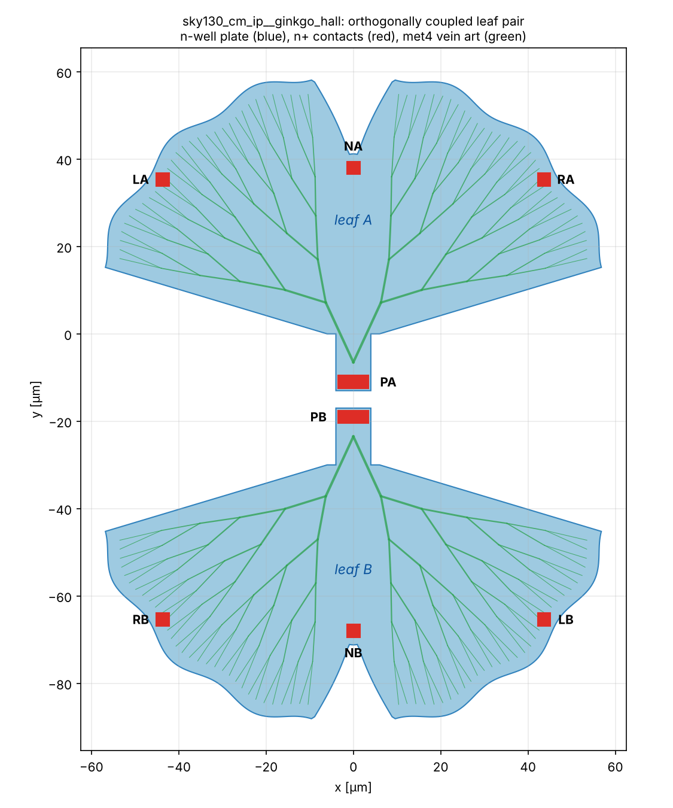

# Proposal: `sky130_cm_ip__ginkgo_hall`

Chipalooza Challenge #4 (Chip Foundry Sky130) — IP block proposal, 23 November 2026

**A Hall-effect magnetic field sensor whose n-well Hall plate is shaped like a ginkgo leaf.**



*Figure 1 — Orthogonally coupled leaf pair (Section 3.3), plotted by `analysis/plot_leaf.py`
from the same geometry model (`layout/ginkgo_geom.py`) that the FD plate model uses.*
- *Blue: n-well blade, which is the Hall plate.*
- *Red: n+ contacts P, R, N, L.*
- *Green: the proposed met4 vein artwork.*
- *Leaf B is leaf A rotated by 180°; the petiole tips are 4 µm apart.*

*This is a geometry plot, not a GDS rendering. Layout starts after the proposal review.*

> **Spelling.** This document uses the botanical spelling *ginkgo* for this block, its files
> and cells, and in running text; the species is *Ginkgo biloba*. The spelling *Gingo biloba*
> appears only as the title of Goethe's 1815 poem.

> **Number labels.** Every number below is tagged in one of three ways.
> - **[sourced]** numbers come with a reference [n] (list at the end).
> - **[estimate]** numbers come with the calculation that produced them. All estimates are
>   computed by `analysis/estimates.py`, and its output is committed as `analysis/estimates.txt`.
> - **[estimate, FD]** numbers come from the finite-element plate model in `analysis/fd_hall.py`.

---

## 0. Motivation

Magnetic field sensing is a common SoC function: contactless current sensing, position and
rotary encoders, lid/switch detection, and BLDC commutation. Silicon Hall plates are the
standard CMOS solution, and they need no extra process steps. No open-source, measured Hall plate exists in
Sky130 (Section 6, *Prior art*). This block provides one, characterised on silicon, as a
building block for later on-chip readout.

The plate is drawn in the outline of a ginkgo leaf. This is a functional choice as well as layout art:
- The van der Pauw theorem [5, 6] says a Hall voltage can be measured on any simply connected
  plate of uniform thickness, using small contacts on its periphery.
- A ginkgo leaf is non-convex because of its notch, but it has no holes, so the theorem applies.
- This block is therefore also a silicon experiment: how close does an odd-shaped plate get to
  a textbook cross-shaped plate, once its contacts are placed well?

---

## 1. Type of IP block

**Analog sensor block:** an integrated Hall-effect magnetic field sensor (out-of-plane field B_z)
with a spinning-current switch matrix.

| Item | Content |
|---|---|
| Sensing element | 2 identical n-well Hall plates with a ginkgo-leaf outline ("leaf A", "leaf B"), plus 1 reference Greek-cross plate ("cross C") of the same n-well |
| Offset cancellation | 4-phase spinning current; orthogonal coupling of leaf A and leaf B; output polarity swap (chopping) for the off-chip readout path |
| On-chip circuitry | 3.3 V transmission-gate switch matrix (`g5v0d10v5` devices); 1.8 V → 3.3 V level shifters (HVL library); optional current mirror for plate bias from the harness reference current |
| Readout | Off-chip, through dedicated pins (preferred) or the shared analog lines |
| Future scope (not part of this proposal) | On-chip chopper preamplifier and demodulator; ADC interface |

---

## 2. List of I/O, including test ports

### 2.1 Pin list

| Pin name | Dir. | Use | Voltage / current range | Harness resource |
|---|---|---|---|---|
| `avdd` | supply | Analog supply: switch matrix, level shifters, optional bias mirror | 3.3 V (3.0–3.6 V) | harness 3.3 V analog supply |
| `avss` | supply | Analog ground; p-substrate and guard rings | 0 V | harness ground |
| `dvdd` | supply | Digital supply (level-shifter low side) | 1.8 V (1.62–1.98 V) | harness 1.8 V digital supply |
| `dvss` | supply | Digital ground | 0 V | harness ground |
| `ibias` | in, analog | Plate bias current from an external precision source or SMU. Enters the active I+ contact and returns to `avss` through the active I− contact | 0–300 µA; compliance 0–2.2 V | **dedicated pin 1** |
| `vhp` | out, analog | Hall voltage, positive output | 0.1–2.0 V; common mode ≈ V_plate/2 | **dedicated pin 2** |
| `vhn` | out, analog | Hall voltage, negative output | 0.1–2.0 V | **dedicated pin 3** |
| `vsp` | out, analog | Kelvin sense of the active I+ contact, for 4-wire R_in and plate temperature | 0–2.2 V | shared analog line 0 |
| `vsn` | out, analog | Kelvin sense of the active I− contact | 0–0.2 V | shared analog line 1 |
| `vhp_s` | out, analog | Fallback copy of `vhp`, connected only when `shr_en` = 1 | as `vhp` | shared analog line 2 |
| `vhn_s` | out, analog | Fallback copy of `vhn`, connected only when `shr_en` = 1 | as `vhn` | shared analog line 3 |
| `iref` | in, analog | Bandgap-referenced current, used as the alternative plate bias (`bsrc` = 1) | per harness current-reference spec (open question Q4) | harness current source 1 |
| `en` | in, dig. | 0: every switch open, mirror off, plate floating (power-down) | 0 / 1.8 V | digital input 0 |
| `ph[1:0]` | in, dig. | Spinning-current phase φ1…φ4 (Section 3.4) | 0 / 1.8 V | digital inputs 1–2 |
| `sel[1:0]` | in, dig. | Plate select: 00 leaf A, 01 leaf B, 10 leaves A‖B orthogonally coupled, 11 cross C | 0 / 1.8 V | digital inputs 3–4 |
| `inv` | in, dig. | Swaps `vhp` ↔ `vhn` (chops the off-chip readout path) | 0 / 1.8 V | digital input 5 |
| `bsrc` | in, dig. | Bias source: 0 = `ibias` pin, 1 = on-chip mirror of `iref` | 0 / 1.8 V | digital input 6 |
| `isel[2:0]` | in, dig. | Mirror gain for `bsrc` = 1 (8 steps; ratios set after Q4 is answered) | 0 / 1.8 V | digital inputs 7–9 |
| `shr_en` | in, dig. | Connects `vhp_s`/`vhn_s` (and `vsp`/`vsn`) to the shared analog lines | 0 / 1.8 V | digital input 10 |
| `ph_q[1:0]` | out, dig. | Read-back of the level-shifted phase state, down-shifted to 1.8 V | 0 / 1.8 V | digital outputs 0–1 |

Resource use: 11 of 24 digital inputs, 2 of 12 digital outputs, 4 of 4 shared analog lines,
3 of 3 dedicated pins, and 1 of 2 harness current sources. The bandgap-referenced bias voltage
is not used.

A bare Hall plate with no support circuitry needs 4 analog terminals. That is one more than the
3 dedicated pins a slot may have [1]. The on-chip switch matrix solves this: it returns the
active I− contact to `avss` on-chip, so one current pin and two Hall-voltage pins are enough,
in every phase. The shared analog lines are used only for the Kelvin senses and the fallback
outputs.

If dedicated pins are not granted, the block still works with `shr_en` = 1. Bias then comes
from `bsrc` = 1, and the Hall voltage goes out on shared lines 2 and 3, with the bandwidth limit
in Section 4.3.

### 2.2 Overvoltage

- No 1.8 V device is connected to a pad. Every pad-facing node (`ibias`, `vhp`, `vhn`, the
  shared lines) touches only n-well/n+ plate contacts and `g5v0d10v5` (5 V-rated) transmission
  gates.
- The 1.8 V control signals come from harness core logic, not from pads, and pass through
  `sky130_fd_sc_hvl` level shifters (`lsbuflv2hv`).
- The n-well/p-substrate junction stays reverse biased as long as all plate nodes are ≥ 0 V.
  This holds because the active I− contact is tied to `avss` through an NMOS switch.

---

## 3. Functional description

### 3.1 Principle

With bias current I in a thin plate and a perpendicular field B_z, the Hall voltage between
the two sense contacts is

  V_H = G_H · (r_H / (q·n·t)) · I · B_z = G_H · µ_H · R_□ · I · B_z  [7]

| Symbol | Meaning |
|---|---|
| G_H ≤ 1 | Geometric correction factor; depends on the shape and on contact size and position |
| r_H | Hall scattering factor |
| µ_H = r_H · µ_n | Hall mobility |
| R_□ = 1/(q·n·µ_n·t) | Sheet resistance of the plate |

Current-related sensitivity is S_I = G_H·µ_H·R_□. Voltage-related sensitivity is
S_V = S_I / R_in.

### 3.2 The ginkgo-leaf plate

The leaf is generated from closed-form math in `layout/ginkgo_geom.py`, not traced from any
image. Default parameters (all in µm):

| Parameter | Value | Note |
|---|---|---|
| Blade radius (base point → lobe crest) | 60 | |
| Fan opening angle | 150° | |
| Central notch | depth 20, half-angle 9°, flat bottom 2.0 | flat bottom ≥ nwell spacing 1.27 [2] |
| Margin lobules | 7 per lobe, amplitude 1.2 | smooth cosine, no cusps |
| Petiole (n-well part) | 13 long × 8 wide | |
| n+ contacts | 3 × 3 (P: 7 × 3), n-well enclosure 0.5 | rule difftap.10: 0.18 [2] |
| Lobe contacts R, L | at ±51° from the leaf axis | chosen by FD, Section 3.3 |
| n-well area per leaf | 4715 µm² [estimate] | shoelace formula on the generated outline |
| Bounding box per leaf | 114 × 71 µm [estimate] | |

**van der Pauw applicability.** The theorem [5, 6] requires four things:
- a plate of uniform thickness,
- that is simply connected (no holes),
- with contacts on the periphery,
- that are small compared with the plate.

The leaf outline is non-convex because of the notch, but simply connected, so the theorem
applies. Shape changes G_H, R_in, R_out and offset; it does not decide whether the Hall effect
can be measured.

Two cautions:
- **Thickness.** The n-well thickness is uniform only to the extent the implant is.
- **Contact size.** Contact size is a trade-off. Larger contacts lower R_in and its noise, but
  also lower G_H by shorting the Hall field. The default 3 µm contacts on a 60 µm blade are
  "small" in the van der Pauw sense.

**Contacts.** There are four, in perimeter order P → R → N → L:

| Contact | Position |
|---|---|
| P | Petiole tip |
| R | Right lobe flank |
| N | Notch bottom (apex of the notch) |
| L | Left lobe flank |

Opposite pairs are (P, N) and (R, L).

### 3.3 Symmetry and offset: the honest version

**What the leaf has.** The leaf has one mirror axis, the line through P and N. It has **no 90°
rotational symmetry**. This has three consequences.

1. **Geometric offset is zero by symmetry.**
   - In phases φ1 and φ3 (current P ↔ N), R and L are mirror images, so they sit at equal
     potential at B = 0.
   - In φ2 and φ4 (current R ↔ L), the mirror axis is an equipotential, and P and N lie on it.
   - The FD model shows a residual of ±(3–6)·10⁻³·R_□·I at B = 0. It changes sign with mesh
     size, so it is a rasterisation artifact, not a property of the shape [estimate, FD].

2. **Random offset cancels for any shape in the linear regime.** Doping gradients, mask
   misalignment and package stress break the mirror symmetry and cause a raw offset. Typical
   integrated silicon Hall plates show 5–50 mT equivalent [16]. For a *linear* plate, spinning
   current cancels this offset for any outline, because of reciprocity (R_ij,kl(B) = R_kl,ij(−B))
   [8, 9; 21, Sec. 3.1].

3. **The residual after spinning comes from nonlinearity.** The main nonlinear terms are:
   - the junction field effect (depletion width depends on the local plate potential),
   - self-heating gradients,
   - thermoelectric voltages at the contacts [9; 21, Sec. 3.2.2].

   These terms cancel only if every phase has the same potential distribution. In a plate
   without 90° symmetry, the "axial" phases (φ1, φ3) and the "transverse" phases (φ2, φ4)
   differ in general, so the residual offset is larger than in a symmetric cross [10].

**Mitigation 1: contact placement that makes the leaf electrically square.** In 2-D, the
plate equation stays conformally invariant even with the junction field effect, and so does
the Hall boundary condition, for these reasons:
- With a sheet conductance that depends on the local potential, the Kirchhoff transform
  U = ∫σ(V)dV turns the plate equation into ∇²U = 0, which is conformally invariant.
- The insulating-edge condition becomes ∂_nU + β·∂_tU = 0 (β = µ_H·B). Both derivatives scale
  the same way under a conformal map, so this condition is invariant too.
- (This is my analysis, not a cited result. It will be checked with an FD model that includes
  σ(V).)

So a mirror-symmetric plate with *point* contacts is equivalent to a disk with four contacts.
P and N map to opposite ends of a diameter, and R and L map to points that are mirror images
across that diameter. The plate is exactly equivalent to a 90°-symmetric disk when R and L are
placed so that **R_PN = R_RL**.

I tuned the lobe-contact angle and the petiole length with the FD model:

| | Value | Label |
|---|---|---|
| Lobe-contact angle | ±51° | |
| Petiole length | 13 µm | |
| R_in in all four phases | 2.619–2.625 R_□ (h = 0.5 µm); 2.601–2.621 R_□ (h = 0.25 µm) | [estimate, FD] |
| Phase-resistance mismatch | < 1 % | [estimate, FD] |
| G_H in all four phases | 0.781 (h = 0.5 µm); 0.776 (h = 0.25 µm) | [estimate, FD] |

Finite contacts and the resistive petiole make the equivalence approximate rather than exact.

**Mitigation 2: an orthogonally coupled leaf pair ("biloba").** Two identical leaves, A and B,
are placed point-symmetric (rotated 180°) about a common centre, with their petioles facing
each other. Their contacts are wired in parallel so that:
- in every phase, leaf A runs in axial mode while leaf B runs in transverse mode, and the
  roles swap on the next phase;
- the composite device has the same potential distribution in all four phases, up to mismatch;
- the common centroid cancels linear doping and stress gradients to first order [12].

**Architecture choice.** The default operating mode is the orthogonally coupled pair
(`sel` = 10), with the balanced contact placement of Mitigation 1. Three reasons:
- Mitigation 1 costs nothing in area or circuitry and makes each leaf behave close to a
  symmetric plate.
- Mitigation 2 removes the remaining axial/transverse asymmetry and averages gradients. It
  costs a second leaf (≈ 0.005 mm² n-well) and doubles the bias current.
- The pair also fits the art: "biloba" means "two-lobed", and Goethe's poem is about one
  leaf that is "one and double".

Leaf A alone, leaf B alone, and a Greek-cross reference plate C (same n-well, 4-fold symmetric)
can also be selected. This lets the measurement separate:
- the shape-related residual (leaf vs cross),
- the coupling-related improvement (pair vs single leaf),
- R_□ and µ_H. The cross is a van der Pauw structure, which resolves open question Q1.

### 3.4 Spinning-current sequence

Phases are selected by `ph[1:0]` [8; 21, Sec. 3.1]. Contacts are listed in perimeter order P, R, N, L.

| `ph` | Phase | Leaf A: I+ → I− / V+, V− | Leaf B (when `sel` = 10) |
|---|---|---|---|
| 00 | φ1 | P → N / R, L | R → L / N, P |
| 01 | φ2 | R → L / N, P | N → P / L, R |
| 10 | φ3 | N → P / L, R | L → R / P, N |
| 11 | φ4 | L → R / P, N | P → N / R, L |

How the phases combine:
- In every phase, the matrix routes the sense contacts so that the Hall voltage has the same
  sign at `vhp − vhn`, while the plate offset alternates sign between successive phases.
- The field estimate is the mean of the four phases.
- `inv` swaps the output polarity. Measuring all 4 phases × 2 polarities also removes the
  offset and thermoelectric voltages of the off-chip path ("spinning + chopping" [12]).

Self-field of the bias leads:
- The bias current produces a magnetic field near its own leads. A 300 µA wire 2 µm away
  produces 30 µT [estimate: µ0·I/(2π·d)], so leads are not routed over the plates.
- The residual self-field reverses with I, so its contribution to V_H is even in I, like
  offset. It therefore cancels under the current reversal φ1 ↔ φ3 and φ2 ↔ φ4.

### 3.5 Block diagram (text)

```
 ibias(pin) ──┬─[bsrc]──┐                                 ┌── vhp (pin) / vhp_s (shared 2)
 iref ─[mirror, isel]─┘  │   ┌─────────────────────────┐   │
                         ├──►│ 3.3 V switch matrix     │───┤   (inv: swap)
                 avss ◄──┼───│ 4 contacts × {I+,I−,V+,V−}│   └── vhn (pin) / vhn_s (shared 3)
                         │   │ × 3 plates (A, B, C)     │──── vsp, vsn (shared 0, 1)
 en, ph, sel, inv ──[HVL level shifters]──►└───────────┘
                         │      │      │
                       leaf A  leaf B  cross C   (n-well in p-sub, p+ guard ring to avss)
```

Switch matrix and phase control follow the Hall instrumentation and digital spin control of
[21, Sec. 3.5.1 and 3.5.3], here without the on-chip amplifier and accumulator.

Size of the switch matrix: 3 plates × 4 contacts × 4 functions = 48 transmission gates, plus
4 for `inv` and 4 for `shr_en`. They are 3.3 V `g5v0d10v5` devices sized for R_on ≈ 200 Ω
[assumption], which adds 2 × 200 Ω to the bias path and 400 Ω to R_out.

### 3.6 Layout art

- **The plate is the art.** The n-well leaf in Figure 1 is the functional device.
- **Veins.** The dichotomous ginkgo venation (two veins entering from the petiole, forking
  repeatedly, fanning out to the margin) is drawn on met4 above each leaf.
  - The veins are mirror-symmetric, so any stress or field-plate effect is symmetric too.
  - They are tied to `avss` through a via stack, so no metal floats.
  - In the final layout, the vein trunks along the leaf base also carry the **sense** lines
    from R and L. Sense lines carry no DC current. Bias-current leads are never routed over a
    plate (Section 3.4).
- **Optional poem line.** The closing line of Goethe's poem *Gingo biloba* (1815, first
  version; public domain) [18] may appear as met5 text in otherwise unused slot area:
  "Daß ich Eins und doppelt bin?" This is decoration only.

Why metal above the plate does not change the Hall effect:
- The Sky130 back end of line (Al/W) contains no ferromagnetic material.
- At DC and low frequency there is no shielding. The skin depth of Al at 100 kHz is 266 µm
  [estimate: √(ρ/(π·f·µ0)), ρ = 2.8·10⁻⁸ Ω·m], versus metal thicknesses of about 1 µm.
- Two second-order effects remain:
  - Mechanical stress under metal can change offset through piezo-resistance.
  - The potential of metal over STI can modulate the n-well surface (field-plate effect).

  Both are reduced by keeping the vein pattern symmetric and at a fixed potential. Section 5
  measures both, by comparing leaves with and without veins (open question Q7).

**Density.**
- The artwork is open line work: met4 veins 0.5–0.8 µm wide on a pitch of ≥ 4 µm, i.e.
  ≤ 20 % local coverage [estimate].
- It must satisfy the open_pdks KLayout density checks: clear-area density ≥ 0.4 on
  li1/met1–met4 and ≥ 0.24 on met5 [4]. The PDK documentation also gives a recommended minimum
  oxide pattern density of 0.7 per 700 µm window for met1–met4 [2].
- Final fill is checked in the slot wrapper.

---

## 4. Target specification

Conditions unless noted: T = 27 °C, `avdd` = 3.3 V, `dvdd` = 1.8 V, per leaf, I_bias = 200 µA
from the `ibias` pin, |B| ≤ 100 mT.

Base model:
- R_□ from the PDK SPICE model `sky130_fd_pr__res_generic_nw` at its corners [3]: 1240 / 1700 / 2160 Ω/□.
- G_H and R/R_□ from the FD model.
- µ_H = r_H·µ_n, with r_H = 1.15 [7, 15] and µ_n from a Caughey–Thomas fit [20] at the effective
  doping implied by R_□. The effective plate thickness is t = 1.1 µm n-well depth [2] − 0.3 µm STI
  [4] − 0.2 µm depletion [assumption] = 0.6 µm, which gives N_eff ≈ 9·10¹⁶ cm⁻³ and
  µ_H ≈ 0.079 m²/Vs [estimate].
- Min/max columns add ±25 % uncertainty in µ_H, because the Caughey–Thomas parameters were not
  verified against Sky130 data.

**Important open question (Q1).** The PDK documentation table lists the n-well sheet
resistance as 950 Ω/□ (550–1350) [2], but the SPICE model uses 1700 Ω/□ (1240–2160) [3].
- S_I scales with R_□ at constant µ_H, so this changes S_I by up to 1.8×.
- S_V and the noise-equivalent field are less affected.
- Cross C measures the real value.

### 4.1 Electrical and magnetic characteristics

| Parameter | Min | Typ | Max | Unit | Label / notes |
|---|---:|---:|---:|---|---|
| `avdd` | 3.0 | 3.3 | 3.6 | V | harness 3.3 V analog [1]; ±10 % [assumption] |
| `dvdd` | 1.62 | 1.8 | 1.98 | V | harness 1.8 V digital [1]; ±10 % [assumption] |
| Bias current per leaf, I_bias | 50 | 200 | 300 | µA | [estimate] limited by plate voltage compliance (next rows) and self-heating |
| Plate voltage at 200 µA | 0.65 | 0.89 | 1.13 | V | [estimate] I·R_in, R_□ corners |
| Plate voltage at 300 µA, 110 °C, max corner | | | 1.99 | V | [estimate] stays below 3.3 V minus the switch drops |
| Input resistance R_in (27 °C) | 3.26 | 4.46 | 5.67 | kΩ | [estimate, FD] 2.625·R_□ |
| R_in over 0–110 °C | 3.13 | | 6.63 | kΩ | [estimate] R_□(T) = R_□·(1 + 1.483e-3·ΔT + 7.824e-6·ΔT²), T_nom = 30 °C [3] |
| Output resistance R_out | 3.26 | 4.46 | 5.67 | kΩ | [estimate, FD] equals R_in to within 1 %; plus 0.4 kΩ for the switches |
| Phase resistance mismatch, axial vs transverse | | 0.8 | 2 | % | [estimate, FD] typ = FD result at h = 0.25 µm (0.2 % at h = 0.5 µm); max allows for mismatch [assumption] |
| Geometric correction factor G_H | 0.77 | 0.78 | 0.80 | — | [estimate, FD] mesh h = 0.25–0.5 µm |
| Current-related sensitivity S_I | 53 | 105 | 171 | V/(A·T) | [estimate] G_H·µ_H·R_□; literature n-well plates 250–310 V/(A·T) in deeper, lighter HV wells [13, 14] |
| Voltage-related sensitivity S_V | 16 | 23.5 | 30 | mV/(V·T) | [estimate] G_H·µ_H/(R_in/R_□); literature range for Si CMOS 10–50 mV/(V·T) [16] |
| Absolute sensitivity at 200 µA | 10.5 | 21 | 34 | µV/mT | [estimate] S_I·I_bias |
| Raw offset, one phase (equivalent field) | −50 | ±10 | 50 | mT | [estimate] literature 5–50 mT [16]; geometric part ≈ 0 by symmetry |
| Residual offset after 4-phase spinning, single leaf | −300 | ±50 | 300 | µT | [estimate] literature 3–15 µT (commercial Si plate [15]) to 480 µT (system level [14]); off-chip readout |
| Residual offset after 4-phase spinning, leaf pair (`sel` = 10) | −100 | ±20 | 100 | µT | [estimate] the coupling removes the axial/transverse asymmetry (Section 3.3) |
| Thermal noise floor, single leaf | | 0.41 | 1.1 | µT/√Hz | [estimate] √(4kT·R_out)/(S_I·I); max at 110 °C, max R_□, min S_I |
| Thermal noise floor, leaf pair (each 200 µA) | | 0.29 | 0.8 | µT/√Hz | [estimate] R_out/2 |
| 1/f noise corner | 1 | 5 | 100 | kHz | [estimate] literature 1–100 kHz [16], 7 kHz at 1 V [15]; n-well under STI, no p+ cover |
| Linear range | −0.5 | | 0.5 | T | [estimate] magnetoresistive term (µ_H·B)² = 0.17 % at 0.5 T; tested to ±0.1 T |
| Nonlinearity over ±100 mT | | | 0.1 | % FS | [estimate] (µ_H·B)² = 0.007 % at 0.1 T |
| Static bandwidth, dedicated pins (−3 dB) | 0.3 | 2 | | MHz | [estimate] (R_out + R_sw)·C, C = 115 pF (pad + board + cable) … 15 pF |
| Static bandwidth, shared lines | | 0.7 | | MHz | [estimate] C ≈ 50 pF [assumption: 18 projects' switches + pad; not specified in [1]] |
| Spinning phase rate | | 1 | 35 | kHz | [estimate] 0.01 % settling = 9.2 τ ≤ 25 % of the phase period, worst-case τ = 0.54 µs; also limited by the harness digital update rate (Q5) |
| Signal bandwidth in spinning mode | | 0.25 | 8 | kHz | [estimate] ≈ phase rate / 4 |
| Operating temperature | 0 | 27 | 110 | °C | rules: commercial, 110 °C accepted [1]; −40 °C goal (R_□ model extrapolated [3]) |
| Supply current `avdd`, static (control, level shifters) | | 0.1 | 1 | µA | [estimate] CMOS leakage, no static current paths |
| Supply current `avdd`, `bsrc` = 1 | | 200 | 600 | µA | [estimate] plate current from the mirror (pair = 2×) |
| Plate power per leaf at 200 µA | | 0.18 | 0.6 | mW | [estimate] I²·R_in; max at 300 µA, max R_□ corner and 110 °C |
| Supply current `dvdd` | | 0.1 | 1 | µA | [estimate] level-shifter input leakage only |
| Power-down plate current (`en` = 0) | | 1 | 100 | nA | [estimate] n-well/p-sub junction and switch leakage at 110 °C |
| Area (standalone block) | | 0.04 | 0.06 | mm² | [estimate] 2 leaves (2 × 114 × 71 µm) + cross (40 × 40 µm) + matrix and level shifters ≈ 250 × 150 µm |

Temperature coefficient of S_I: no sourced Sky130 value exists. It will be characterised and
reported, not specified. Open question Q2.

### 4.2 Absolute maximum ratings

| Parameter | Min | Max | Unit | Label / notes |
|---|---:|---:|---|---|
| `avdd` to `avss` | −0.3 | 5.5 | V | [sourced] `g5v0d10v5` SPICE validity V_GS ≤ 5.5 V [2]; harness pads are 3.3 V |
| `dvdd` to `dvss` | −0.3 | 1.95 | V | [sourced] `nfet_01v8` validity V_DS, V_GS ≤ 1.95 V [2] |
| Digital inputs | −0.3 | `dvdd` + 0.3 | V | [estimate] junction forward-bias limit |
| `ibias`, `vhp`, `vhn`, `vsp`, `vsn`, shared lines | −0.3 | `avdd` + 0.3 | V | [estimate] pad ESD diodes and n-well/p-sub junction must not forward bias |
| `ibias` current | | 0.5 | mA | [estimate] plate voltage ≈ 3.3 V at the max R_□ corner and 110 °C |
| Magnetic flux density | | none | | no ferromagnetic material in the block; package and test fixture set the practical limit |
| Junction temperature | | 125 | °C | [assumption] to be aligned with the harness package rating |

### 4.3 Usage notes for an SoC designer

- With 200 µA bias, the output is about 21 µV/mT on a 0.9 V common mode. A useful readout
  needs a chopper amplifier with < 0.3 µV/√Hz input noise and a gain of about 1000. That
  amplifier is future scope.
- The block works as a raw sensor with any external or on-chip readout that can follow the
  spinning phases. The phase settling time is < 8 µs worst case [estimate].

---

## 5. Test plan (measurement-based, outline)

**Equipment.** The list is sent separately, per the rules. Categories needed:
- field source plus a reference magnetometer,
- magnetic shield,
- source-measure unit,
- low-noise voltmeter or lock-in amplifier,
- microcontroller,
- temperature chamber or hot chuck.

**Setup.**
- Packaged harness chip on a non-magnetic test board: no ferromagnetic connectors, screws or
  stiffeners near the die.
- Phase control (`ph`, `sel`, `inv`, `en`) from a microcontroller through the harness digital
  inputs. Its firmware runs the 4 phases × 2 polarities sequence (Section 3.4) and records
  each reading with its state, read back via `ph_q`.
- Plate bias from an SMU into `ibias`. Hall voltage read with a nanovoltmeter, or with a
  lock-in amplifier referenced to the phase clock.

| # | Test | Method | Result |
|---|---|---|---|
| T1 | Connectivity and resistances | For each plate and phase, force I at `ibias` and read `vsp − vsn` (4-wire) | R_in, R_out per phase; phase mismatch; comparison with FD (2.62·R_□) |
| T2 | Sheet resistance and Hall mobility | van der Pauw on cross C [5]: R_□ from two reciprocal configurations; µ_H from Hall voltage in a known B | R_□ (resolves Q1), µ_H, G_H of the leaf = S_I(leaf) / (µ_H·R_□) |
| T3 | Zero-field offset | Board in a mu-metal can, at B < 1 µT. All phases, polarities and `sel` modes; I_bias = 50…300 µA | Raw offset per phase; residual after spinning; single leaf vs pair vs cross; offset vs I_bias (nonlinearity) |
| T4 | Sensitivity | Helmholtz coil (±5 mT, current-controlled, calibrated with a reference fluxgate or Hall probe at the DUT position); then a permanent magnet on a translation stage for ±100 mT, against the gaussmeter | S_I, S_V, absolute sensitivity; linearity; agreement between phases |
| T5 | Noise | In the shield; FFT of `vhp − vhn` per static phase (0.1 Hz–100 kHz); spinning-mode noise vs phase rate | Thermal floor, 1/f corner, noise-equivalent field |
| T6 | Temperature | Hot chuck or chamber, 0…110 °C (−40 °C if available); repeat T1, T3, T4 | R_□(T), S_I(T), offset drift; plate temperature from R_in |
| T7 | Bandwidth and settling | Step `ph`; capture the `vhp` transition with an oscilloscope | Phase settling time, max phase rate; dedicated-pin vs shared-line path |
| T8 | Supply and power-down | `avdd`/`dvdd` currents per mode; `en` = 0 leakage | Supply currents |
| T9 | Art vs function (optional) | If one leaf is drawn without veins (Q7), compare offset and drift between the two leaves | Effect of metal over the plate |

**Pass criteria.** Typical values within the min/max columns of Section 4.1. Measured values
replace the [estimate] entries in the documentation.

---

## 6. Prior art

No Sky130 Hall plate was found. Searches covered GitHub repositories and code, Efabless and
Caravel listings, Tiny Tapeout, IEEE and arXiv (2026-11-23). A gap in this search: the Tiny
Tapeout project gallery could not be searched exhaustively.

| Work | Process | Plate | Status | What this block does differently |
|---|---|---|---|---|
| Hecmac/TTIHP-Hall-Sensor [17] (Apache-2.0) | IHP SG13G2 | 40 × 40 µm cross, spinning at ~100 kHz, on-chip amplifier and flash ADC | simulated and DRC-clean; not submitted, no measurements, no sensitivity or offset numbers published | Sky130; measured; raw plate accessible; orthogonally coupled pair; reference cross on the same die |
| Xu et al. 2012 [13] | X-FAB 0.18 µm HV | cross, 64 × 64 µm | measured S_I ≈ 310 V/(A·T) | open source; standard (non-HV) n-well; non-symmetric outline |
| Huang et al. 2015 [14] | 0.8 µm HV CMOS | cross, 20 µm | measured S_V = 0.034 /T; 0.48 mT residual | as above |

The only Sky130 match found is a Tiny Tapeout motor driver that reads *external* Hall
sensors. It has no on-chip plate.

## 7. Open questions

| Q | Question | Plan |
|---|---|---|
| Q1 | Which n-well R_□ applies to a plate under STI without diffusion: 950 Ω/□ (docs [2]) or 1700 Ω/□ (SPICE model [3])? | Measure with cross C (T2); before then, carry both in the schematic simulation |
| Q2 | Electron mobility and its temperature dependence in the Sky130 n-well (retrograde profile, peak 6·10¹⁷ cm⁻³ [2]); TC of S_I | Measure (T2, T6); look for TCAD data |
| Q3 | Are three dedicated pins granted, and which analog pad cell is used? | Ask the organisers; fallback uses shared lines only (Section 2.1) |
| Q4 | Value and range of the harness bandgap-referenced current sources | Sets the `isel` mirror ratios |
| Q5 | Maximum update rate of the harness digital inputs | Sets the maximum spinning rate in a test |
| Q6 | Package type and die-attach stress | Affects raw offset and drift |
| Q7 | Should one leaf be drawn without vein art, as a control for T9? | Default: both leaves with veins (mirror-symmetric) |
| Q8 | Is a p+ top cover over the plate worth it for lower 1/f noise and surface shielding? | Default: none (STI cover); decide at the schematic review |

## 8. Repository, verification and license

- Sources at the proposal stage:
  - `layout/ginkgo_geom.py`: parametric leaf outline, contacts and veins, generated from math.
  - `analysis/fd_hall.py`: FD plate model.
  - `analysis/estimates.py`: every number in Section 4.
  - `analysis/plot_leaf.py`: Figure 1.
- Layout note for the next stage: the open_pdks KLayout deck flags non-45° edges (rule x.3a)
  and vertices off the 5 nm grid (rule x.1b) on n-well and metals [4]. The GDS generator
  will therefore convert the smooth outline into an octilinear (0/45/90°) polygon on a 5 nm
  grid, and draw the veins as Manhattan shapes. G_H and R_in will be re-checked with the FD
  model on that exact polygon.
- To be added at later stages: Xschem schematic, ngspice testbenches, Magic/KLayout DRC and
  LVS sign-off, and the slot wrapper. In the testbenches, the plate is a SPICE macro-model.
  It is built from a box-integration discretization of the leaf outline: the galvanomagnetic
  conductance matrix is split into symmetric (resistor) and antisymmetric (Hall) elements and
  written out as netlist lines [21, Ch. 2]. The structure will follow the challenge repository template.
- Open-source tools only. AI was used to support drafting; the user of the block does not need
  it.
- License: Apache 2.0.

## References

1. Chipalooza Challenge #4 rules. https://opencircuitdesign.com/chipalooza/rules-4.html (read 2026-11-23).
2. SkyWater SKY130 PDK documentation: GDS layers (`docs/rules/gds_layers.csv`), periphery rules (nwell.1/2a/4, difftap.10, licon.*, li.*, ct.*, m1.*–m5.*, via*.*, m*.pd.*), device details (RSNW table `res_generic-table0.rst`; `nfet_01v8` and `nfet_g5v0d10v5` operating voltages), design assumptions (n-well depth 1.1 µm, peak 6·10¹⁷ cm⁻³). https://skywater-pdk.readthedocs.io/en/main/rules.html, https://github.com/google/skywater-pdk/tree/main/docs/rules
3. open_pdks sky130A, version 2fdf40d5736413bb321c31418462aefc17b919b8: `libs.tech/ngspice/sky130_fd_pr__model__r+c.model.spice` (`res_generic_nw`, tc1 = 1.483e-3, tc2 = 7.824e-6, tnom = 30) and `r+c/res_*__cap_*.spice` (rnw = 1240 / 1378 / 1700 / 2022 / 2160 Ω/□).
4. open_pdks sky130A KLayout tech: `drc/sky130A_mr.drc`, `drc/met_min_ca_density.lydrc` (clear-area density ≥ 0.4 li1–met4, ≥ 0.24 met5), `tech/xsect/sky130.xs` (illustrative STI depth 0.3 µm).
5. L. J. van der Pauw, "A method of measuring specific resistivity and Hall effect of discs of arbitrary shape," *Philips Research Reports* 13, 1–9 (1958).
6. L. J. van der Pauw, "A method of measuring the resistivity and Hall coefficient on lamellae of arbitrary shape," *Philips Technical Review* 20, 220–224 (1958). (Conditions as summarised by NIST: https://www.nist.gov/pml/nanoscale-device-characterization-division/popular-links/hall-effect/hall-effect)
7. R. S. Popović, *Hall Effect Devices*, 2nd ed., IOP Publishing, 2004. ISBN 0-7503-0855-9, doi:10.1887/0750308559.
8. P. J. A. Munter, "A low-offset spinning-current Hall plate," *Sensors and Actuators A* 22, 743–746 (1990). doi:10.1016/0924-4247(89)80069-X.
9. U. Ausserlechner, "Limits of offset cancellation by the principle of spinning current Hall probe," *Proc. IEEE Sensors 2004*, 1117–1120. doi:10.1109/ICSENS.2004.1426372.
10. U. Ausserlechner, "An analytical theory of the signal-to-noise ratio of Hall plates with four contacts and a single mirror symmetry," *J. Appl. Math. Phys.* 6, 2032–2066 (2018). doi:10.4236/jamp.2018.610174.
11. U. Ausserlechner, "The signal-to-noise ratio and a hidden symmetry of Hall plates," *Solid-State Electronics* 135, 14–23 (2017). doi:10.1016/j.sse.2017.06.007.
12. A. Bilotti, G. Monreal, R. Vig, "Monolithic magnetic Hall sensor using dynamic quadrature offset cancellation," *IEEE JSSC* 32(6), 829–836 (1997). doi:10.1109/4.585275.
13. Y. Xu et al., *Sensors* 12(2), 2162–2174 (2012). doi:10.3390/s120202162.
14. H. Huang, D. Wang, Y. Xu, *Sensors* 15(10), 27359–27373 (2015). doi:10.3390/s151027359.
15. K. M. Dowling et al., "Low offset and noise in high biased GaN 2DEG Hall-effect plates investigated with infrared microscopy," *J. Microelectromech. Syst.* 29(5), 669–676 (2020). doi:10.1109/JMEMS.2020.3013187 (Table I: Si reference plate).
16. R. S. Popović, "Hall magnetic sensor devices," IMMW20 (2017). https://www.diamond.ac.uk/dam/jcr:407d663c-217d-441d-95fd-7701e65f9971/IMMW20_Popovic.pdf
17. Hecmac, TTIHP-Hall-Sensor. https://github.com/Hecmac/TTIHP-Hall-Sensor
18. J. W. von Goethe, *Gingo biloba* (first version 15 Sept. 1815; *West-östlicher Divan*, 1819). Text as given in https://de.wikipedia.org/wiki/Gingo_biloba
19. *Ginkgo biloba* (botanical name). https://en.wikipedia.org/wiki/Ginkgo_biloba
20. D. M. Caughey, R. E. Thomas, "Carrier mobilities in silicon empirically related to doping and field," *Proc. IEEE* 55(12), 2192–2193 (1967). doi:10.1109/PROC.1967.6123. (The fit parameters used in `estimates.py` are textbook values and were not verified within the proposal timebox.)
21. C. Maier, *CMOS Circuits for Magnetic Microsensors based on Simple Sensor Models* (extended version of the doctoral thesis "Equivalent circuit models and interface circuits for CMOS microsensors," Diss. ETH No. 13532), ETH Zürich, 2000. https://github.com/tatzelbrumm/Zeugnisse/blob/master/PhD.pdf — Ch. 2: box-integration Hall-plate models and their SPICE netlist translation; Ch. 3: spinning-current method, sensitivity to nonidealities, Hall instrumentation, digital spin control.
